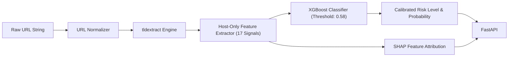

# 🛡️ PhishDetect — Phishing URL Detector

[](https://github.com/Roastee/phishing-url-detector/actions/workflows/ci.yml)
[](https://www.python.org/downloads/)
[](LICENSE)
[](https://fastapi.tiangolo.com)
[](Dockerfile)

> **Production-grade Machine Learning system for real-time phishing URL detection using host-only syntactic and lexical features.** Built with rigorous data-leakage auditing, calibrated decision thresholds, and FastAPI REST services. The Streamlit UI lives on the `main` branch.

---

---

## 📌 Table of Contents

- [Overview & Architecture](#-overview--architecture)
- [Key Finding: Dataset Leakage Audit](#-key-finding-dataset-leakage-audit)
- [Feature Engineering (17 Host-Only Signals)](#-feature-engineering-17-host-only-signals)
- [Model Performance & Evaluation](#-model-performance--evaluation)
  - [In-Distribution Test](#in-distribution-test-n17783)
  - [Independent Generalization Benchmark](#independent-generalization-benchmark-openphish--tranco)
- [Limitations & Honest Reporting](#-limitations--honest-reporting)
- [Repository Structure](#-repository-structure)
- [Quick Start](#-quick-start)
  - [Local Installation](#local-installation)
  - [Running the FastAPI Backend](#running-the-fastapi-backend)
  - [Running with Docker](#running-with-docker)
- [API Reference](#-api-reference)
- [Testing & Quality Assurance](#-testing--quality-assurance)
- [Security & Ethics](#-security--ethics)
- [License](#-license)

---

## 🔍 Overview & Architecture

Modern phishing campaigns frequently rotate domains, leverage automated domain generation, and deploy across shared cloud hosting infrastructures. Many traditional machine-learning models achieve artificially inflated accuracy (e.g., >99% F1) by memorizing path artifacts, URL schemes, and training dataset collection flaws.

**PhishDetect** is engineered from the ground up to prevent feature leakage by enforcing a strict **host-only feature extraction policy**:
- **Zero URL Fetching:** Analyzes URLs strictly as text strings. It never queries DNS, opens HTTP connections, or resolves targets — making scanning 100% safe and zero-latency.
- **Path & Query Neutral:** Ignores paths (`/login.php`), URL parameters, and protocols (`https://`, `www.`), focusing purely on domain structure, lexical entropy, and registrar/hosting markers.
- **Explainable Predictions:** Integrates SHAP (Tree/Linear explainers) and rule-based diagnostic markers so analysts see *why* an alert triggered.



---

## 🔬 Key Finding: Dataset Leakage Audit

During development, extensive auditing of popular phishing benchmark datasets (including UCI PhiUSIIL) revealed severe structural collection leakage:

| Feature | Legitimate URLs (Tranco / Benchmark) | Phishing URLs (PhishTank / OpenPhish) |
|---|:---:|:---:|
| `https://www.` prefix | **100%** | **41.5%** |
| HTTPS scheme | **100%** | **49.0%** |
| Non-empty path (`/login`, `/auth`) | **0%** | **61.0%** |

Full-URL models learned that legitimate domains are formatted as `https://www.domain.com/` while phishing URLs contain paths. An uncalibrated full-URL model achieved **0.9935 F1** simply by memorizing this dataset artifact.

**PhishDetect completely strips protocol, `www.` prefixes, paths, and query parameters**, enforcing generalization to real-world threats.

---

## ⚙️ Feature Engineering (17 Host-Only Signals)

All 17 features are extracted in sub-millisecond Python routines without external network dependencies:

| Category | Features | Description |
|---|---|---|
| **Host Structure** | `host_length`, `dot_count`, `hyphen_count`, `underscore_count` | Length and punctuation density across subdomain and registered domain |
| **Digit Analysis** | `digit_count`, `digit_ratio`, `longest_digit_run` | Detection of randomly generated hosts or IP evasion |
| **Subdomain Complexity** | `subdomain_count`, `longest_consonant_run` | Domain hierarchy depth and unpronounceable consonant clusters |
| **TLD & Encoding** | `is_suspicious_tld`, `uses_punycode`, `has_ip_address` | Flags suspicious TLDs (`.tk`, `.xyz`, `.top`, `.zip`), IDN homograph Punycode (`xn--`), and raw IP hostnames |
| **Brand Impersonation** | `brand_in_subdomain` | Detects targeted brands (`paypal`, `apple`, `microsoft`, `google`, etc.) nestled in subdomains |
| **Keywords & Shorteners**| `suspicious_keyword_count`, `uses_url_shortener` | Target keywords (`login`, `verify`, `banking`, `wallet`) and URL shortener detection |
| **Information Theory** | `host_entropy` | Shannon character entropy quantifying domain randomness |
| **Infrastructure** | `on_known_hosting_platform` | Detection of shared free/PaaS hostnames (`github.io`, `vercel.app`, `pages.dev`, `workers.dev`) |

---

## 📊 Model Performance & Evaluation

### In-Distribution Test (n = 17,783)

Evaluated against held-out test splits after leakage-free domain clustering:

| Model | Accuracy | Precision | Recall | F1 Score | ROC-AUC | PR-AUC | False Positive Rate |
|---|:---:|:---:|:---:|:---:|:---:|:---:|:---:|
| Logistic Regression | 0.842 | 0.916 | 0.730 | 0.812 | 0.871 | 0.899 | 5.88% |
| Random Forest | 0.838 | 0.908 | 0.726 | 0.807 | 0.865 | 0.895 | 6.41% |
| **XGBoost (Deployed)** | **0.844** | **0.934** | **0.716** | **0.811** | **0.862** | **0.896** | **4.42%** |

*Deployment Threshold:* Selected at **0.58** to ensure an operational low false-positive rate (~2% target on validation).

### Independent Generalization Benchmark (OpenPhish + Tranco)

To guard against distribution shift, PhishDetect was evaluated on fresh, unseen real-world data: **296 confirmed OpenPhish URLs** tested against **Tranco top rank and long-tail legitimate domains**:

| Test Slice | Phishing (n) | Legitimate (n) | Precision | Recall (95% CI) | FPR |
|---|:---:|:---:|:---:|:---:|:---:|
| **Balanced (1:1 Ratio)** | 296 | 296 | **0.966** | 0.767 [0.720, 0.813] | **2.70%** |
| **Imbalanced (1:10 Ratio)** | 296 | 2,960 | **0.676** | 0.767 [0.718, 0.815] | **3.68%** |
| Free-Hosted Phishing Slice | 169 | — | — | **1.000** [1.000, 1.000] | — |
| Custom-Domain Phishing Slice | 131 | — | — | **0.559** [0.466, 0.641] | — |

---

## ⚠️ Limitations & Honest Reporting

1. **Shared Platform Ambiguity:** On shared platforms (e.g. `*.pages.dev`, `*.github.io`, `*.vercel.app`), legitimate developer sites and malicious phishing pages share the same base domain suffix. The UI explicitly flags this with an **Uncertain** alert rather than making a high-confidence claim.
2. **Recall on Non-Free Custom Domains:** While free-hosted phishing recall is near ~100%, phishing registered on novel custom domains with benign lexical structures achieves ~55.9% recall.
3. **Realistic Production Prevalence:** In enterprise web traffic where phishing prevalence is ~0.1% to 1%, precision adjusts to 2.8% - 22.3% due to base rate fallacy. This tool is best used as a high-speed pre-filter in defense-in-depth pipelines.

---

## 📁 Repository Structure

```text
phishing-url-detector/
├── .github/workflows/
│   └── ci.yml               # Automated GitHub Actions CI (lint, compile, pytest)
├── api/
│   └── main.py              # FastAPI REST service with rate-limiting & validation
├── app/
│   └── app.py               # Streamlit web application (on `main` branch)
├── data/                    # Dataset storage & ingestion scripts
├── docs/
│   └── AUDIT.md             # Security and code audit report
├── models/
│   ├── metadata.json        # Model hyperparameters, feature list, and thresholds
│   └── model.joblib         # Trained XGBoost model artifact
├── reports/
│   ├── metrics.json         # Comprehensive benchmark evaluation metrics
│   └── pr_curve.png         # Precision-Recall curve visualization
├── src/phishdetect/
│   ├── __init__.py          # Package initialization
│   ├── explain.py           # SHAP-based feature attribution
│   ├── features.py          # 17 Host-only feature extraction logic
│   ├── predict.py           # Unified inference pipeline
│   └── train.py             # Model training and hyperparameter evaluation
├── tests/
│   ├── test_api.py          # FastAPI endpoint integration tests
│   ├── test_consistency.py  # Model inference consistency checks
│   ├── test_features.py     # Feature extraction unit tests
│   ├── test_metadata.py     # Metadata validation tests
│   └── test_predict.py      # Prediction pipeline tests
├── Dockerfile               # Container deployment configuration
├── pyproject.toml           # PEP 517 / 621 package metadata
├── requirements.txt         # Pinned Python dependencies
└── README.md
```

---

## 🚀 Quick Start

### Local Installation

Clone the repository and set up a virtual environment:

```bash
git clone https://github.com/Roastee/phishing-url-detector.git
cd phishing-url-detector

python -m venv .venv
# On Windows:
.venv\Scripts\activate
# On Linux/macOS:
source .venv/bin/activate

pip install -r requirements.txt
```

### Running the FastAPI Backend

Start the REST API with Uvicorn:

```bash
uvicorn api.main:app --host 0.0.0.0 --port 8000 --reload
```
Interactive Swagger documentation is available at `http://localhost:8000/docs`.

### Running with Docker

Build and execute the production container:

```bash
# Build Docker image
docker build -t phishdetect .

# Run FastAPI service
docker run -p 8000:8000 phishdetect
```

---

## 📡 API Reference

### Health Check
`GET /health`
```json
{
  "status": "ok",
  "model_version": "0.1.0"
}
```

### Predict Single URL
`POST /predict` (Rate-limited to 60 req/min)

**Request Body:**
```json
{
  "url": "https://secure-login.paypal.verify-account.tk/auth"
}
```

**Response:**
```json
{
  "url": "https://secure-login.paypal.verify-account.tk/auth",
  "label": "phishing",
  "probability": 0.985,
  "risk_level": "high",
  "reasons": [
    {
      "feature": "is_suspicious_tld",
      "value": 1.0,
      "impact": 1.0,
      "explanation": "Uses suspicious TLD 'tk'"
    },
    {
      "feature": "brand_in_subdomain",
      "value": 1.0,
      "impact": 1.0,
      "explanation": "Contains brand 'paypal' in subdomain"
    },
    {
      "feature": "suspicious_keyword_count",
      "value": 2.0,
      "impact": 2.0,
      "explanation": "Contains 2 suspicious keywords (login, verify)"
    }
  ]
}
```

### Predict Batch
`POST /predict/batch` (Max 100 URLs per request)

---

## 🧪 Testing & Quality Assurance

The codebase maintains automated test coverage across feature extraction, prediction sanity, API contracts, and metadata integrity.

Run the test suite:
```bash
pytest -v
```

Lint and syntax checks:
```bash
ruff check app src api tests
python -m compileall -q app src api tests
```

---

## 🔒 Security & Ethics

- **No Remote Network Requests:** PhishDetect does not connect to, download, or resolve target domains.
- **Privacy First:** Predictions can be executed completely air-gapped without logging submitted URLs.
- **Academic & Operational Use:** Built for cyber defenders, incident response teams, and security researchers.

---

## 📄 License

Distributed under the **MIT License**. See [LICENSE](LICENSE) for details.
